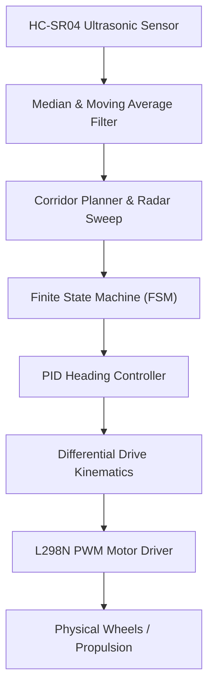

# 🏎️ Autonomous-RoboCar-Autonomy
### Embedded Mobile Robotics Navigation & Obstacle Avoidance Stack

[](#)
[](#)
[](#)
[](#)

A modular, embedded autonomous navigation framework for 2-wheel differential drive robotic vehicles. Features forward/inverse kinematics, hybrid sensor noise filtering, multi-angle radar corridor sweeping, a finite state machine (FSM), and closed-loop PID control.

---

## 📌 Architecture Overview



---

## ⚡ Quickstart

### 1. Run Automated Unit Tests
```bash
python main.py --mode test
```

### 2. Run 2D Autonomous Navigation Simulation
```bash
python main.py --mode sim
```

---

## 👨‍💻 Author
**LKSHAY TYAGI**  
*SRM Institute of Science and Technology, Delhi-NCR*  
*Specialization: Autonomous Systems, Robotics & Embedded Intelligence*
