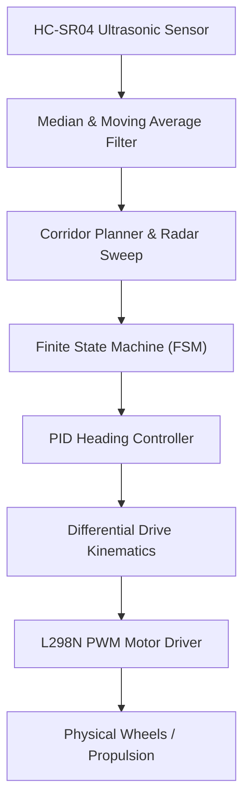

# 🏎️ Autonomous-RoboCar-Autonomy
### Embedded Mobile Robotics Navigation & Obstacle Avoidance Stack

A modular, embedded autonomous navigation framework for 2-wheel differential drive robotic vehicles.

---

## 📌 Architecture Overview

